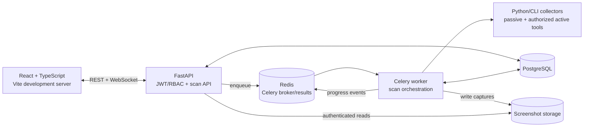

<p align="center">
  
</p>

<h1 align="center">🔍 OSINT Reconnaissance Platform</h1>

<p align="center">
  <b>Automated open-source intelligence — domains, IPs, emails, secrets, and brand threats</b><br>
  <i>Dockerized • 30+ collector implementations • Real-time WebSocket updates</i>
</p>

<p align="center">
  
  
  
  
  
  
</p>

---

## Project Status

This repository is under active development. It is already a working local
investigation platform rather than a production-hosted scanning service. The
current emphasis is reconnaissance quality, evidence handling, authorized
assessment workflows, and analyst experience.

Implemented foundations include:

- Domain, IP, and organization scan entry points with passive, validated, and
  active profiles.
- Canonical asset inventory, scope manifests, exclusions, wildcard detection,
  public-IP validation, and candidate/resolved/live asset states.
- Passive discovery, DNS and email posture, RDAP, RIPEstat/ASN enrichment,
  Common Crawl, Wayback, HTTP validation, and manual screenshot evidence.
- Explicit authorized assessment jobs for Naabu/Nmap, conservative Nuclei,
  TLS assessment, scoped crawling, takeover verification, and bounded content
  discovery.
- Authenticated multi-user workspaces, collaborators, live job progress,
  evidence pagination, entity graphing, and CSV/JSON/PDF export.
- Finding and asset observation history with first-seen, last-seen,
  observation-count, and revision metadata.
- A frontend/backend entity contract check and automated API, collector, and
  browser smoke-test tooling.

The next development sequence is documented in [Recommended Development
Order](#recommended-development-order). Historical planning documents remain
in the repository for context, but the source code and this README are the
current operational reference.

## Contents

- [What It Does](#-what-it-does)
- [Quick Start](#-quick-start)
- [Configuration](#-configuring-api-keys)
- [Scan Workflow](#-how-to-use)
- [Architecture](#-architecture)
- [Testing and Logs](#-commands-quick-reference)
- [Recommended Development Order](#recommended-development-order)
- [Security](#-security)

---

## ✨ What It Does

Run a full reconnaissance pipeline against any domain, IP address, or organization — automatically. The platform discovers subdomains, finds email addresses, scans for leaked secrets, profiles web technologies, detects lookalike domains, monitors brand mentions, and visualizes the relationship graph.

**One command to start. One click to scan. Real-time results.**

| Capability | Example Output |
|---|---|
| 🏗️ **Infrastructure** | Subdomains, IPs, DNS/email posture, RDAP registration, ASN/BGP routing context, SSL certs, HTTP evidence screenshots |
| 📧 **Identity** | Emails (Hunter.io), account existence (holehe), social profiles (maigret) |
| 🔑 **Secrets** | Potential API-key, password, and token indicators in public GitHub code |
| 🌐 **Web OSINT** | Tech stack, CVEs, Wayback/Common Crawl history, scoped crawling, TLS posture, and manual content discovery |
| 🎭 **Brand Protection** | Lookalike domains (dnstwist), Telegram monitoring |
| 🧠 **AI Assistant** | Generate Google dorks from natural language (Groq-powered) |
| 🔗 **Entity Graph** | Interactive visualization of all connections |
| 📊 **Reports** | Export findings as PDF |

---

## 🚀 Quick Start

### Prerequisites

- [Docker](https://docs.docker.com/get-docker/) 24+ and Docker Compose v2
- Node.js `20.19+` or `22.12+` for the Vite 8 frontend
- Git
- 4 GB RAM minimum, 8 GB+ recommended

### Setup

```bash
# Clone the repo
git clone https://github.com/ahmedchafra/automated-osint.git
cd automated-osint

# Configure API keys (optional — works without them too)
cp backend/.env.example backend/.env
# Edit backend/.env with your API keys (see below)

# Start the backend (PostgreSQL, Redis, API, worker)
docker compose up -d --build

# Apply the database schema
docker compose exec backend alembic upgrade head

# In a separate terminal, start the frontend
cd frontend
npm install
npm run dev
```

### Open the App

| URL | What |
|---|---|
| http://localhost:5173 | 🖥️ Frontend — register an account, start scanning |
| http://localhost:8000/docs | 📚 API docs (Swagger) |

---

## 🔧 Configuring API Keys

Collectors are organized in tiers. The platform works **without API keys** for
many sources, including DNS, crt.sh, Subfinder, RDAP, RIPEstat, Common Crawl,
Wayback Machine, Holehe, Maigret, dnstwist, and Shodan InternetDB. Optional keys
enable richer or higher-rate sources.

Copy `backend/.env.example` to `backend/.env`; never commit the resulting file.

| Key | Integration | Purpose |
|---|---|---|
| `SHODAN_API_KEY` | Shodan | Host and service enrichment |
| `CENSYS_API_ID` + `CENSYS_API_SECRET` | Censys | Host and certificate intelligence |
| `HUNTER_API_KEY` | Hunter.io | Domain email discovery |
| `HIBP_API_KEY` | Have I Been Pwned | Authenticated breach checks |
| `GITHUB_TOKEN` | GitHub | Public repository and code-search evidence |
| `BUILTWITH_API_KEY` | BuiltWith | Web technology profiling |
| `SERPER_API_KEY` | Serper | Search and dork execution |
| `GROQ_API_KEY` | Groq | AI-assisted dork generation |
| `NVD_API_KEY` | NVD | Higher-rate CVE enrichment |
| `WHOXY_API_KEY` | Whoxy | Reverse-WHOIS enrichment |
| `TG_API_ID`, `TG_API_HASH`, `TG_SESSION_STRING` | Telegram | Telegram monitoring |

The GitHub collector only needs public-search access. Prefer a fine-grained,
short-lived token with no added repository permissions. Do **not** paste tokens
into chat, issues, screenshots, logs, or committed files. See
[GitHub token setup](docs/github-token.md).

The **theHarvester** adapter can use additional providers. Each configured key
enables another source; provider availability and quotas can change, so consult
the provider's current documentation rather than relying on fixed limits here.

| Provider group | Environment variables |
|---|---|
| Internet and DNS intelligence | `VT_API_KEY`, `URLSCAN_API_KEY`, `OTX_API_KEY`, `LEAKIX_API_KEY`, `DNSDUMPSTER_API_KEY`, `SECURITYTRAILS_KEY`, `FULLHUNT_API_KEY`, `BEVIGIL_API_KEY` |
| Search and discovery | `BRAVE_API_KEY`, `MOJEEK_API_KEY`, `NETLAS_API_KEY`, `ZOOMEYE_API_KEY`, `CRIMINALIP_API_KEY` |
| Optional paid providers | `INTELX_API_KEY`, `ONYPHE_API_KEY`, `FOFA_API_KEY`, `DEHASHED_API_KEY`, `WHOISXML_API_KEY`, and others defined in `backend/app/config.py` |

Edit `backend/.env` with your keys, then restart:

```bash
docker compose restart backend worker
```

> 🔑 **Full documentation** on every API key and collector is in [DOCUMENTATION.md](DOCUMENTATION.md#6-api-keys--which-ones-you-need).

---

## 🧭 How to Use

### 1. Register & Log In

Open the frontend, create an account, and log in. New accounts are regular users.
To bootstrap the first administrator, set all three `INITIAL_ADMIN_USERNAME`,
`INITIAL_ADMIN_EMAIL`, and `INITIAL_ADMIN_PASSWORD` variables before starting the
backend. Alternatively, promote a user with the documented administration script.

### 2. Start a Scan

Click **"New Scan"**, choose a target type:

```
🌐 example.com  →  Full domain pipeline
📡 8.8.8.8      →  IP-focused pipeline (RDAP/RIPEstat/Shodan/Censys)
🏢 Acme Inc     →  Org discovery → domain pipeline
```

Choose an interaction mode before launching:

| Mode | Behavior |
|---|---|
| **Passive** | Third-party/public datasets only; discovered hosts remain candidates. |
| **Validated** | Adds wildcard-aware DNS resolution and bounded HTTP `HEAD` liveness checks. This is the default. |
| **Active** | Includes validation and unlocks explicit analyst-triggered assessment: Naabu → Nmap plus parallel Nuclei, TLS-posture, bounded scoped-crawl, non-invasive takeover verification, and manual content-discovery profiles. |

For domain scans, the primary pipeline is deterministic and profile-aware:

1. crt.sh, Subfinder, Common Crawl, and Wayback discover evidence; RDAP enriches
   the domain. Findings pass a shared contract and become canonical candidate
   assets before downstream work begins.
2. Validated/Active scans add DNS/email posture, wildcard sampling, bounded DNS
   validation, and public-IP filtering. Resolved hosts are promoted to
   `RESOLVED`; a bounded, no-redirect HTTP `HEAD` probe promotes responsive
   hosts and URLs to `LIVE`.
3. Only verified in-scope live URLs reach web-surface collection. Only public
   resolved IPs reach Shodan, RDAP, and RIPEstat enrichment. Active assessment,
   screenshots, and content discovery remain explicit analyst-triggered jobs.

Passive mode does not run target DNS/MX probes, dnstwist resolution, Holehe, or
service validation. It records third-party/public evidence as candidates so an
analyst can choose when to validate it.

Domain assets now move through a durable lifecycle: `CANDIDATE` (discovered),
`RESOLVED` (public DNS evidence), and `LIVE` (HTTP response observed). Wildcard
DNS matches remain visible as evidence but are excluded from IP/service fan-out.
Discovery results are canonicalized before persistence: invalid, private, and
out-of-scope values are dropped; duplicates from the same collector are merged
with a bounded evidence trail; and independent collector hits remain separate
evidence while contributing to one canonical asset. A hostname is classified as
wildcard-derived only when its complete DNS signature is covered by the sampled
wildcard baseline, avoiding false positives from a single shared CDN address.
Every asset discovery and lifecycle change is also written to an append-only
observation timeline with its collector, state, scope decision, timestamp, and
bounded evidence snapshot. The Infrastructure workspace exposes first seen,
last seen, observation counts, and the latest timeline events. Existing assets
receive a `BASELINE` observation when the timeline migration is applied.

### 3. Explore Results

The scan workspace has tabbed views:

| Tab | What You'll Find |
|---|---|
| **Overview** | Backend-reported totals, asset/job health, entity coverage, severity, sources, recent evidence, and the editable scope boundary |
| **All Evidence** | Server-paginated access to every stored finding with entity/severity/search filters and expandable normalized/raw collector data |
| **Infrastructure** | Canonical assets, subdomains, IPs, DNS/TLS/ASN context, screenshots, lifecycle observations, and deep analysis |
| **Identity** | Emails, breach status, social profiles |
| **Secrets** | Paginated GitHub exposure leads with type, confidence, proximity, repository/file links, job health, and related repository context |
| **Brand Protection** | Lookalike domains, Telegram brand mentions |
| **Threat Intel** | Combined secret scan + lookalike detection |
| **Web OSINT** | Technologies, CVEs, versions, Wayback/Common Crawl URLs, TLS/crawl evidence, and manual content discovery |
| **Entity Graph** | Interactive relationship graph of all findings |

The frontend maintains an exhaustive display catalog for the backend entity
taxonomy. The production build fails if a backend `EntityType` is not mapped,
while **All Evidence** provides a safe generic representation immediately so a
successful collector cannot silently produce invisible data. Specialist tabs
remain bounded for responsive interaction; the canonical evidence view uses
database-backed pagination and therefore remains complete for large scans.
Specialist workspaces are code-split and loaded on demand, keeping the initial
investigation bundle small even as individual collectors gain richer views.
Overview metrics use the database-backed `/api/scans/{scan_id}/facets` endpoint,
so entity, severity, source, asset, and job totals remain exact even when the
interactive evidence snapshot is capped.

The GitHub exposure collector requires `GITHUB_TOKEN`. Missing or rejected
authentication is recorded as a failed job instead of being presented as a
successful zero-result search. Repository context is anchored to the exact
target domain, short brand names require token-boundary matches, and findings
far from the target are scored conservatively. Findings are still hypotheses:
the UI does not claim repository ownership or credential validity. Secret
values and downloaded file contents are never persisted—only classification,
confidence/proximity signals, repository/file metadata, and public links.
Rows produced before the current exact-domain classifier remain immutable
historical evidence and are marked as legacy in the Secrets view.

Repeated observations now refresh the existing canonical finding instead of
being discarded as duplicate no-ops. Every finding exposes first seen, last
seen, observation count, and revision. Observation count advances on every
repeat; revision advances only when severity, confidence, normalized/raw data,
or tags change. The All Evidence view displays this lifecycle metadata. Absence
from a collector run is not treated as deletion because rate-limited providers
can return partial result sets.

### 4. Go Deeper

Click **"Deep Analysis"** on a domain to run mode-aware enrichment and CVE
cross-referencing. Interactive web collectors only receive verified, in-scope,
non-wildcard assets. On scans created in **Active** mode, the Canonical Asset
Inventory also exposes **Run active validation**. That action requires an
authorization confirmation and caps target fan-out. Network and web probes run
only against persisted public `RESOLVED`/`LIVE` assets; takeover verification also
checks in-scope, non-wildcard subdomain candidates for fresh dangling-DNS evidence.
Nuclei redirects, OAST/Interactsh, and templates
tagged `dos`, `fuzz`, `intrusive`, or `headless` are disabled.

The scoped crawler performs GET requests only, checks the scope manifest before
every request and redirect, freshly resolves and pins public destination IPs,
and is limited to 10 seeds, 50 pages, depth 2, and concurrency 4. Forms are
inventory evidence and are never submitted. Query-bearing URLs, JavaScript
assets, downloads, and action-like paths such as logout/delete are recorded
without being fetched; query values and response bodies are not persisted.

Active scans also expose **Manual Content Discovery** in Web OSINT. This is a
separate on-click job, never an automatic branch of active validation. The
`common` profile checks 16 reviewed discovery paths (such as `robots.txt`,
security.txt, API documentation, login, health, and status paths); the
`exposure` profile checks 12 commonly exposed file/debug paths and requires an
extra browser confirmation. Each run is capped at 5 verified live origins with
concurrency 4, performs GET requests only, disables redirects, freshly resolves
and pins public destination IPs, and reads at most 128 KiB per response. A
random missing-path response is collected per origin to suppress custom-404
false positives. Stored findings contain status, content type/length, title,
SHA-256, a non-secret marker identifier, and baseline metadata. Response bodies
and query values are never stored.

Takeover verification refreshes CNAME/A/AAAA records for at most 100 scoped
subdomains. Recognized dangling provider records are reported separately from
provider-specific unconfigured-site fingerprints. Optional confirmation is one
public-IP-pinned root-page GET with redirects disabled and a 256 KiB limit; only
the matched marker and response hash are stored. It never creates an account,
claims a provider resource, uploads content, or reports claimability as proven.

Validated and Active scans can also capture authenticated screenshot evidence for
verified live URLs. Captures are manual, scope-checked, public-IP pinned, hashed,
and stored with their metadata in the scan workspace. Passive scans still receive
standardized RDAP domain registration data without contacting the target host.
Common Crawl adds a bounded, passive latest-index lookup for historical URLs
and candidate subdomains; requests are serialized and rate-limited to respect
the public CDXJ service. A recursive-DNS posture collector also reports SPF,
DMARC, common DKIM selectors, MTA-STS/TLS-RPT advertisements, MX, CAA, DNSSEC
delegation state, and nameserver health. It does not contact SMTP services,
fetch the MTA-STS HTTPS policy, or claim full DKIM/DNSSEC validation.

The container image pins Naabu, Nuclei, and the Nuclei template set; Nmap is
installed from the Debian image repository. Active results appear as port/service
findings and takeover evidence in Infrastructure, and Nuclei/TLS/crawl findings in Web OSINT. TLS assessment
checks supported protocol versions, certificate dates, hostname coverage, public
CA trust, signature algorithm, and key strength for verified HTTPS assets.

---

## 🏗️ Architecture



### Runtime workflow

1. The React frontend creates a scan through FastAPI and receives a scan ID.
2. FastAPI validates the target/profile, persists the scan, and dispatches a
   Celery task through Redis.
3. The worker runs the appropriate domain, IP, or organization orchestration
   path. Collectors return normalized finding contracts rather than writing
   directly to the UI.
4. Findings, assets, observations, links, screenshots, and job state are stored
   in PostgreSQL. Repeat evidence refreshes lifecycle metadata instead of
   creating unbounded duplicates.
5. Redis-backed progress events reach the browser through the scan WebSocket;
   REST queries remain the canonical source for stored results.
6. Specialist frontend tabs interpret the normalized entity taxonomy. The All
   Evidence view remains the complete, server-paginated fallback.

---

## 📦 Project Structure

```
├── docker-compose.yml       # PostgreSQL, Redis, API, and worker
├── backend/
│   ├── Dockerfile           # Python, browser, and pinned CLI tools
│   ├── .env.example         # Local configuration template
│   ├── alembic/             # Database migrations
│   ├── requirements.txt
│   ├── app/
│   │   ├── api/             # FastAPI REST/WebSocket routes
│   │   ├── workers/         # Celery tasks (scan orchestration)
│   │   ├── models/          # SQLAlchemy models
│   │   ├── schemas/         # Pydantic request/response schemas
│   │   ├── services/        # Scope, persistence, validation, exports
│   │   └── core/            # Auth, security, config
│   ├── collectors/          # Auto-discovered collector adapters
│   │   ├── infrastructure/  # DNS, subfinder, RDAP, RIPEstat...
│   │   ├── identity/        # Hunter, breaches, GitHub evidence...
│   │   ├── services/        # HTTP, technology, CVE, host intelligence
│   │   ├── search/          # Archives, search, lookalikes, Telegram
│   │   └── username/        # Maigret and simple profiling
│   ├── scripts/             # Source smoke tests
│   └── tests/               # Backend test suite
└── frontend/
    ├── scripts/             # Contract and browser smoke checks
    ├── src/
    │   ├── api/             # Axios client and WebSocket helper
    │   ├── components/      # Shared and workspace components
    │   ├── pages/           # Route pages
    │   ├── context/         # React context providers
    │   ├── domain/          # Exhaustive entity display catalog
    │   └── types/           # API contracts
    └── package.json
```

---

## 🛠️ Commands Quick Reference

```bash
docker compose up -d                 # Start backend services
docker compose up -d --build         # Rebuild & start (after image changes)
cd frontend && npm run dev           # Start frontend (separate terminal)
docker compose logs -f               # View all logs
docker compose logs -f worker        # View worker logs only
docker compose down                  # Stop all containers
docker compose down -v               # Factory reset (deletes all data)
docker compose restart backend worker  # Restart after Python/.env changes
docker compose exec backend alembic upgrade head  # Apply migrations
docker compose ps                    # Check service health/state

# Verification
cd backend && pytest -q               # Backend safety/API/worker tests
cd backend && python scripts/source_smoke.py          # Bounded public-source contract smoke
cd backend && python scripts/source_smoke.py --slow-only   # CLI/Tor-backed sources
cd backend && python scripts/source_smoke.py --keyed-only  # Configured API providers
cd frontend && npm run lint           # ESLint (zero-error baseline)
cd frontend && npm run check:contract # Backend EntityType ↔ frontend catalog
cd frontend && npm run build          # Contract check + TypeScript + production bundle
python frontend/scripts/ui_smoke.py --scan-id <completed-scan-id>  # Read-only all-route browser smoke
python frontend/scripts/ui_smoke.py --scan-id <id> --test-scope-save  # Also persist the existing scope unchanged
```

`source_smoke.py` reports provider availability separately from parsing and
contract validity: an empty result is not automatically treated as a healthy
keyed provider. `ui_smoke.py` visits every route and workspace tab at desktop
size, checks the overview/evidence/scope controls, repeats the core workspace at
mobile size, verifies that GitHub evidence is paginated and uses repository
metadata rather than compound identifiers, requires the locally bundled
Cytoscape canvas, and fails on browser
exceptions, console errors, horizontal mobile overflow, authentication
redirects, or API responses with status 400+.

---

## 📖 Full Documentation

For a complete walkthrough covering every feature, button, API key, and troubleshooting step, see:

➡️ **[DOCUMENTATION.md](DOCUMENTATION.md)**

Includes:
- Step-by-step usage of every workspace tab
- All API keys with free-tier limits and sign-up links
- Detailed troubleshooting guide
- How to share the app with someone else
- Quick reference cheat sheet

---

## 🧪 How It Looks

| View | Description |
|---|---|
| Dashboard | Scan cards with live progress, severity breakdowns |
| Workspace | Tabbed deep-dive into findings per vector |
| Entity Graph | Interactive Cytoscape graph of connections |
| Pipeline Progress | Real-time WebSocket progress per collector |
| AI Assistant | Natural language → Google dork generation |

---

## 🔒 Security

- JWT-based authentication with role-based access control (Admin / User / Viewer)
- API keys are stored in server-side `.env` only — never exposed to the frontend
- Use short-lived, least-privilege API tokens. Revoke a token immediately if it
  appears in chat, terminal output, screenshots, issues, commits, or logs.
- Collaborator system lets you share scans without sharing credentials
- Active collectors consume the canonical asset inventory and re-check scope plus public-IP resolution before network access
- Content discovery is manual-only, bounded, custom-404-aware, and stores no response bodies
- GitHub exposure collection stores evidence metadata and public links, never matched secret values or downloaded file contents
- Docker container isolation

## Recommended Development Order

The older roadmap predates several features now present in the codebase. Based
on the current persistence and pipeline architecture, the highest-value next
steps are:

### 1. Collector run-quality contract

Add a durable result envelope for every collector invocation with statuses such
as `complete`, `partial`, `rate_limited`, `failed`, and `skipped`, plus timing,
attempt count, result count, and a sanitized error category. This prevents an
empty or truncated provider response from being mistaken for evidence removal.

This should be implemented before automatic stale/resolved transitions.

### 2. Evidence state transitions

Build on finding lifecycle metadata with explicit `active`, `changed`, `stale`,
and `resolved` states. Only a complete collector run should be permitted to mark
previous evidence stale. Preserve the observation/revision history so analysts
can explain every transition.

### 3. Scan comparison and continuous timeline

Compare scans for the same normalized target: new assets, disappeared assets,
changed DNS/TLS/service state, new exposures, and remediated findings. Display
the differences in a timeline with evidence links, not only numeric deltas.

### 4. Intelligence and prioritization

Add EPSS and OSV enrichment first, followed by URLhaus, ThreatFox, urlscan,
GreyNoise caching, JavaScript/source-map analysis, and public-document metadata.
Keep enrichment parallel where inputs already exist; chain only the operations
that truly depend on validated assets, discovered technologies, or CVEs.

### 5. Investigation workflow

Add cases/campaigns, evidence snapshots, analyst notes, finding disposition
(confirmed/false-positive/accepted risk), reproducible reports, entity pivots,
and scheduled monitoring. These features turn individual scans into durable
investigations.

### 6. Incremental frontend decomposition

Continue splitting the large Infrastructure, Dashboard, and Entity Graph views
into tested panels and hooks. The specialist tabs are already lazy-loaded, so
this work should focus on maintainability and interaction performance rather
than a visual rewrite.

### Suggested next implementation slice

Start with steps 1 and 2 as one vertical slice:

1. Define the collector-run schema and migration.
2. Persist outcome metadata from the shared collector runner.
3. Expose it through scan jobs/facets.
4. Display complete/partial/rate-limited state in the workspace.
5. Add lifecycle transitions guarded by completeness.
6. Test successful, empty, partial, rate-limited, retry, and failed runs at the
   service, API, database, and browser layers.

After that foundation is stable, scan comparison becomes substantially safer
and easier to trust.

---

## 🤝 Contributing

1. Fork the repo
2. Create a feature branch (`git checkout -b feature/my-feature`)
3. Commit changes (`git commit -m 'Add my feature'`)
4. Push to the branch (`git push origin feature/my-feature`)
5. Open a Pull Request

---

## 📄 License

This project is for authorized security testing, educational purposes, and CTF challenges only. Ensure you have proper authorization before scanning any domain or system.
