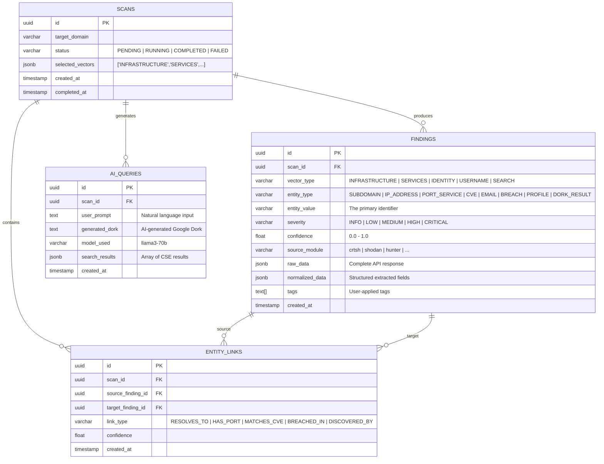

# Automated OSINT Platform — Technical Architecture Blueprint

> **Project Title:** Conception et développement d'une plateforme d'automatisation OSINT
> **Architect:** Lead Full-Stack Engineer
> **Date:** 2026-06-18
> **Status:** Awaiting Approval
> **Revision:** 1.1 — Updated with independent research validation

> [!CAUTION]
> **Critical Research Findings Applied:** Independent tool validation revealed that **Google Custom Search Engine API is being sunset** (closed to new customers, final shutdown January 2027). The plan has been updated to use **Serper.dev** as the primary search API. Additionally, **Maigret** (3,000+ sites) has been added as a superior alternative to Sherlock (400 sites) for username enumeration.

---

## Executive Summary

This document presents the complete system architecture for a **centralized, automated OSINT intelligence platform**. The system ingests data from 5 distinct reconnaissance vectors (Infrastructure, Services/Vulnerabilities, Identity/Leaks, Username Profiling, AI-Powered Search), normalizes all findings into a unified data model, and presents them through a premium interactive dashboard. The platform enforces strict passive OPSEC, supports plugin-based extensibility, and includes an AI Recon Assistant powered by Groq/Llama 3.

---

## Phase A: Technical Stack — Final Decision

After evaluating your proposed stack and conducting independent research, I **validate and refine** your choices as follows:

### Backend Core

| Layer | Technology | Version | Rationale |
|:---|:---|:---|:---|
| **API Framework** | FastAPI | 0.115+ | Natively async (ASGI), automatic OpenAPI docs, Pydantic v2 validation, WebSocket support built-in. Best-in-class for Python async APIs. |
| **Python Runtime** | Python | 3.11+ | Required for `asyncio.TaskGroup`, performance improvements, and `tomllib` support. |
| **Task Queue** | Celery | 5.4+ | Battle-tested distributed task queue. Handles long-running OSINT scans as background jobs with retry, chaining, and chord primitives. See note below on modern alternatives. |
| **Message Broker** | Redis | 7+ | Dual role: Celery message broker AND result backend. Also used for WebSocket pub/sub (real-time scan progress) and rate-limit counters. |
| **ORM / DB Driver** | SQLAlchemy 2.0 + asyncpg | Latest | SQLAlchemy 2.0's native async session with asyncpg provides true non-blocking database I/O. SQLModel adds Pydantic integration for models. |
| **Database** | PostgreSQL | 16+ | Relational integrity for structured data + native `JSONB` columns for unstructured raw intelligence. Full-text search via `tsvector`. GIN indexes on JSONB for fast queries. |
| **Migrations** | Alembic | Latest | SQLAlchemy-native migration tool. Auto-generates migration scripts from model changes. |

> [!NOTE]
> **Celery vs Modern Alternatives:** Research identified **Taskiq** and **ARQ** as async-native alternatives to Celery that integrate more naturally with FastAPI's async architecture. However, Celery remains our choice for two reasons: (1) its **chord/chain/group** workflow primitives are essential for our multi-vector parallel scanning + enrichment pipeline, and (2) it has 15+ years of production battle-testing, superior documentation, and Flower monitoring dashboard. If Celery's sync worker model becomes a bottleneck, we can migrate to Taskiq (which has a similar API) in a later phase.

### Frontend Core

| Layer | Technology | Rationale |
|:---|:---|:---|
| **Build Tool** | Vite + React 18 | Fastest HMR, ideal for local/on-premise SPA (no SSR needed unlike Next.js). Lightning-fast dev experience. |
| **Language** | TypeScript | Type safety is non-negotiable for a data-heavy dashboard. Catches errors at compile time. |
| **UI Components** | Mantine v7 | Enterprise-grade component library with dark mode built-in, excellent data tables, and a cybersecurity-appropriate aesthetic. Far more complete than Shadcn/ui for a dashboard. |
| **Data Viz (Charts)** | Recharts | Declarative, composable React charts. Excellent for time-series, bar charts, risk gauges, pie charts. |
| **Graph/Network Viz** | Cytoscape.js + react-cytoscapejs | Industry standard for entity-relationship graphs. Can render complex OSINT link graphs (domain → IP → port → CVE → breach) with hundreds of nodes efficiently. |
| **Data Tables** | TanStack Table v8 | Headless, fully customizable. Supports server-side pagination, filtering, sorting, column resizing, and export. |
| **State Management** | TanStack Query (React Query) v5 + Zustand | React Query for all server state (API caching, refetching, optimistic updates). Zustand for lightweight client-side UI state (filters, modals, selected scan). |
| **Real-time** | Native WebSocket API | FastAPI WebSocket endpoint → React `useEffect` hook. Broadcasts scan progress, task completion events, and live data ingestion counts. |
| **HTTP Client** | Axios | Interceptors for auth tokens, error handling, and request/response transformation. |
| **Routing** | React Router v6 | Standard SPA routing with nested layouts. |
| **Icons** | Tabler Icons | 5,400+ icons, MIT license, perfect for cybersecurity UIs. |

### Infrastructure (Local Development)

| Component | Technology | Notes |
|:---|:---|:---|
| **Containerization** | Docker + Docker Compose | Single `docker-compose.yml` spins up PostgreSQL, Redis, FastAPI, Celery worker, and React dev server. |
| **Reverse Proxy** | Traefik (optional) | For production deployment only. Routes `/api` to FastAPI, `/` to React. |
| **OPSEC Proxy** | Tor SOCKS5 + Rotating HTTP Proxies | Configurable per-module. See Phase C. |

> [!IMPORTANT]
> **Why Vite + React over Next.js?** This is an on-premise security tool, not a public website. We don't need SSR, ISR, or edge functions. Vite gives us the fastest development experience, smallest bundle, and zero unnecessary complexity. The SPA communicates purely through the FastAPI REST + WebSocket API.

> [!IMPORTANT]
> **Why Mantine over Shadcn/ui?** Mantine provides 100+ production-ready components out of the box (complex data tables, date pickers, notifications, modals, multi-selects) with built-in dark mode. Shadcn/ui requires building each component manually and has no built-in state management — unsuitable for the rapid development pace of this project.

---

## Phase B: OSINT Vector & Tool Selection Matrix

### Vector 1: Infrastructure & Asset Discovery

| Source | Data Points Collected | Why This Source | Mode |
|:---|:---|:---|:---|
| **crt.sh** (Certificate Transparency) | Subdomains from SSL/TLS certificate logs | Free, no API key, massive dataset from CT logs. JSON API at `https://crt.sh/?q=%.domain.com&output=json`. Most reliable passive subdomain source. | 🟢 **Fully Passive** |
| **Subfinder** (ProjectDiscovery) | Subdomains from 40+ passive sources | Aggregates SecurityTrails, Shodan, VirusTotal, Censys, etc. in one tool. Go binary, called as subprocess from Python. Returns deduplicated, clean subdomain list. | 🟢 **Fully Passive** |
| **dnspython** | A, AAAA, MX, TXT, CNAME, NS, SOA records; resolved IPs | Pure Python DNS resolver. Direct queries to public DNS resolvers (8.8.8.8, 1.1.1.1). No external API dependency. Async-capable. | 🟡 **Active** (DNS queries to resolvers, not to target infrastructure) |

**Implementation Strategy:**
```
crt.sh API → raw subdomain list
   + Subfinder subprocess → merged subdomain list
      → dnspython bulk resolve → structured DNS records + IP addresses
```

> [!NOTE]
> DNS resolution sends queries to public DNS resolvers, NOT directly to target infrastructure. This is standard passive reconnaissance and does not alert the target.

---

### Vector 2: Service & Passive Vulnerability Mapping

| Source | Data Points Collected | Why This Source | Mode |
|:---|:---|:---|:---|
| **Shodan API** | Open ports, service banners, OS fingerprints, SSL certificates, technologies detected, geolocation | The world's largest internet-wide scanner. Query by IP — Shodan has already scanned it. Python SDK: `shodan`. $49 lifetime membership for individual use. | 🟢 **Fully Passive** (queries Shodan's existing database) |
| **Shodan InternetDB** | Open ports, known vulns, tags, CPEs, hostnames | **Free, no API key needed.** Endpoint: `https://internetdb.shodan.io/{ip}`. Significantly faster than the full API. Ideal for bulk IP enrichment. | 🟢 **Fully Passive** |
| **Censys Search API v2** | Open ports, service banners, TLS certificates, protocol detection | Complementary to Shodan. Better TLS/certificate analysis. New SDK: `censys-platform`. Free community tier available. | 🟢 **Fully Passive** |
| **NIST NVD API 2.0** | CVE IDs, CVSS v3.1 scores, vulnerability descriptions, affected software versions (CPE matches) | Official US government vulnerability database. Free, no API key required (but key increases rate limit to 50 req/30s). Matches CPE strings from Shodan/Censys banners to known CVEs. | 🟢 **Fully Passive** |
| **CISA KEV Catalog** | Actively exploited CVE IDs, required action dates, vendor advisories | Supplements NVD enrichment gaps. Free JSON feed, no API key. Critical for prioritizing real-world threats over theoretical CVEs. | 🟢 **Fully Passive** |

> [!WARNING]
> **NIST NVD Enrichment Gap (April 2026 Policy Change):** NIST now uses risk-based enrichment — only prioritizes CVSS scores/CPE mappings for CVEs in CISA's KEV catalog, federal software, and critical software. Many lower-priority CVEs may lack complete data. We mitigate this by combining NVD with the **CISA KEV catalog** for authoritative exploit intelligence.

**Implementation Strategy:**
```
Discovered IP (from Vector 1)
   → Shodan InternetDB /ip (FREE, bulk) → ports, vulns, CPEs, tags
   → Shodan API /shodan/host/{ip} (detailed) → banners, technologies, geo
   → Censys /v2/hosts/{ip} → TLS, protocols
      → Extract CPE strings from banners
         → NIST NVD /cves/2.0?cpeName={cpe} → matched CVEs + severity scores
         → CISA KEV catalog → flag actively exploited vulnerabilities
```

> [!TIP]
> **Enrichment Pipeline:** When Vector 1 discovers an IP, it automatically triggers Vector 2. The user never needs to manually initiate vulnerability lookups — the system chains them via Celery task workflows.

---

### Vector 3: Identity & Leak Intelligence

| Source | Data Points Collected | Why This Source | Mode |
|:---|:---|:---|:---|
| **Hunter.io API** | Email patterns (e.g., `{first}.{last}@domain.com`), discovered employee emails, email verification status, sources | Best-in-class email finder API. Returns verified corporate email addresses with confidence scores. Free tier: 25 searches/month. Paid plans scale well. | 🟢 **Fully Passive** |
| **HaveIBeenPwned API v3** | Breach names, breach dates, compromised data types (passwords, emails, IPs), paste metadata | Troy Hunt's authoritative breach database. Per-email lookup. Requires $3.50/month API key (hibp-api-key header). Returns structured breach metadata. | 🟢 **Fully Passive** |

**Implementation Strategy:**
```
Target domain
   → Hunter.io /domain-search → email pattern + list of discovered emails
      → For each email: HIBP /breachedaccount/{email} → breach history
         → Aggregate: "john.doe@target.com appeared in LinkedIn breach (2012), Adobe breach (2013)"
```

> [!WARNING]
> **HaveIBeenPwned API key is mandatory.** The free web interface doesn't support programmatic access. Budget $3.50/month for the API key. This is non-negotiable for production use.

---

### Vector 4: Username Profiler (Sherlock-Style)

| Source | Data Points Collected | Why This Source | Mode |
|:---|:---|:---|:---|
| **Custom Async Profiler Engine** (Maigret-inspired) | Profile URLs, account existence (boolean), platform names, user bios, linked accounts, HTTP status codes, detection timestamps | We build our own async implementation inspired by **Maigret's** site catalog (~3,000+ platforms) rather than Sherlock (~400). Maigret extracts richer metadata (bios, linked accounts) and has lower false-positive rates. Our async version using `aiohttp` can check 3,000 sites in <30 seconds. | 🟡 **Active** (sends HTTP requests to 3,000+ platforms) |

**Implementation Strategy:**
```
Username input
   → Load Maigret-derived site catalog (JSON: 3,000+ sites with detection rules)
      → aiohttp.ClientSession with semaphore (100 concurrent)
         → For each site: HEAD/GET request → classify as FOUND/NOT_FOUND/ERROR
            → Extract metadata: bio, linked accounts, profile image hash
               → Store results with timestamps
```

> [!TIP]
> **Why Maigret over Sherlock?** Independent research confirmed Maigret covers **3,000+ sites** (vs Sherlock's 400), extracts richer metadata (bios, linked accounts), and has hand-tuned detection rules that reduce false positives. We use Maigret's site catalog data but build our own async engine for full control over OPSEC, retry logic, and proxy routing.

> [!CAUTION]
> **OPSEC Critical:** This vector sends direct HTTP requests to 3,000+ websites. It MUST route through the OPSEC proxy layer (Tor/rotating proxies). User-Agent rotation is mandatory. Rate limiting prevents IP bans. Note: many sites actively block known Tor exit nodes — use rotating residential proxies as the primary OPSEC layer, with Tor as a fallback.

---

### Vector 5: AI-Powered Content & Search Risk (The "AI Recon Assistant")

| Source | Data Points Collected | Why This Source | Mode |
|:---|:---|:---|:---|
| **Groq API** (Llama 3 70B) | AI-generated Google Dork queries, natural language processing of analyst prompts | Fastest LLM inference API available (~500 tokens/sec). Free tier: 30 req/min, 14,400 req/day. Llama 3 70B is excellent at structured query generation. No data retention on Groq's servers. | 🟢 **Passive** (API call to Groq) |
| **Serper.dev API** | URLs of exposed files, sensitive document links, cached page snippets, result metadata, People Also Ask data | Modern Google SERP API — fastest and most cost-effective Google results proxy. 2,500 free queries, then $50/50k queries. Returns structured JSON with organic results, snippets, and knowledge graph data. | 🟢 **Passive** (API call to Serper) |

**Implementation Strategy:**
```
Analyst prompt: "Find leaked database configs for target.com"
   → Groq API: System prompt instructs Llama 3 to output Google Dork syntax
      → Generated: site:target.com filetype:sql OR filetype:env OR filetype:bak
         → Serper.dev API → list of matching URLs with snippets
            → Store: prompt, generated dork, results, timestamps
```

> [!NOTE]
> **Why Groq over OpenAI?** Three reasons: (1) Groq's free tier is generous enough for development and light production. (2) Llama 3 is open-source — no vendor lock-in. (3) Groq's inference speed is 10x faster than OpenAI, critical for interactive UX.

> [!CAUTION]
> **Google CSE Sunset Notice:** Google Custom Search Engine API is **closed to new customers** and will be fully shut down **January 1, 2027**. We use **Serper.dev** as the replacement — it's faster, cheaper, and provides richer structured data (organic results, knowledge graph, People Also Ask). Alternative: SerpApi (more expensive but supports 80+ search engines).

---

### API Key Requirements Summary

| Service | Free Tier | Cost for Production | Required? |
|:---|:---|:---|:---|
| crt.sh | Unlimited, no key | Free | ✅ No key needed |
| Subfinder | Free, open source | Free | ✅ No key needed |
| dnspython | Free, open source | Free | ✅ No key needed |
| Shodan InternetDB | Unlimited, no key | Free | ✅ No key needed |
| Shodan API | $49 lifetime membership | $49 one-time | ✅ Key needed |
| Censys | Community tier (free) | Free tier sufficient for MVP | ✅ Key needed |
| NIST NVD | Unlimited (no key), 50 req/30s (with key) | Free | ⚠️ Key recommended |
| CISA KEV | Unlimited, no key | Free | ✅ No key needed |
| Hunter.io | 25 searches/month (free) | $49/month (Starter) | ✅ Key needed |
| HaveIBeenPwned | No free API | $3.50/month | ✅ Key needed |
| Groq | 30 req/min, 14,400 req/day | Free tier sufficient | ✅ Key needed |
| Serper.dev | 2,500 free queries | $50/50k queries | ✅ Key needed |

---

## Phase C: Core Architectural Strategies

### C.1: Data Normalization — The Unified Intelligence Model

The fundamental challenge: How do you store a subdomain, a leaked password, a social media profile, and a CVE score in the same database?

**Solution: Typed Entity Model with JSONB Raw Storage**

Every piece of intelligence is stored as a **Finding** — a universal record with:
- **Fixed columns** for querying: `id`, `scan_id`, `vector_type`, `entity_type`, `entity_value`, `severity`, `confidence`, `created_at`
- **JSONB column** (`raw_data`) for the complete, unstructured source response
- **JSONB column** (`normalized_data`) for the structured, vector-specific fields

```
┌─────────────────────────────────────────────────────────────────────┐
│                         findings table                              │
├──────────────┬────────────────┬──────────────────────────────────────┤
│ id (UUID)    │ scan_id (FK)   │ vector_type (ENUM)                  │
│ entity_type  │ entity_value   │ severity (ENUM: INFO/LOW/MED/HIGH/  │
│              │                │          CRITICAL)                   │
│ confidence   │ source_module  │ created_at                          │
│ raw_data     │ normalized_data│ tags (ARRAY)                        │
│ (JSONB)      │ (JSONB)        │                                     │
└──────────────┴────────────────┴──────────────────────────────────────┘
```

**Entity Type Taxonomy:**

| entity_type | entity_value example | normalized_data example |
|:---|:---|:---|
| `SUBDOMAIN` | `api.target.com` | `{"resolved_ips": ["1.2.3.4"], "dns_records": {"A": [...], "MX": [...]}}` |
| `IP_ADDRESS` | `1.2.3.4` | `{"open_ports": [80, 443, 8080], "asn": "AS13335", "org": "Cloudflare"}` |
| `PORT_SERVICE` | `1.2.3.4:443` | `{"protocol": "https", "banner": "nginx/1.21", "cpe": "cpe:2.3:a:nginx:nginx:1.21"}` |
| `CVE` | `CVE-2021-44228` | `{"cvss_score": 10.0, "severity": "CRITICAL", "affected_cpe": "..."}` |
| `EMAIL` | `john@target.com` | `{"pattern": "{first}@target.com", "verified": true, "sources": ["linkedin"]}` |
| `BREACH` | `LinkedIn-2012` | `{"email": "john@target.com", "breach_date": "2012-06-05", "data_classes": ["passwords"]}` |
| `PROFILE` | `https://github.com/johndoe` | `{"platform": "GitHub", "username": "johndoe", "exists": true}` |
| `DORK_RESULT` | `https://target.com/.env` | `{"dork_query": "site:target.com filetype:env", "snippet": "DB_PASSWORD=..."}` |

**Why this works:**
1. **Fixed columns** enable fast SQL queries: `WHERE vector_type = 'INFRASTRUCTURE' AND severity = 'CRITICAL'`
2. **JSONB `raw_data`** preserves the exact API response for forensic traceability
3. **JSONB `normalized_data`** stores structured fields with GIN indexes for fast JSONB queries
4. **PostgreSQL GIN indexes** on JSONB enable queries like: `WHERE normalized_data @> '{"cvss_score": 10.0}'`
5. **Entity-value design** enables cross-vector correlation (same IP found in infrastructure AND vulnerability vectors)

---

### C.2: Operational Security (OPSEC) Architecture

```
┌─────────────────────────────────────────────────────────────┐
│                     OPSEC Proxy Layer                        │
│                                                              │
│   ┌──────────────┐   ┌──────────────┐   ┌──────────────┐   │
│   │  User-Agent  │   │    Proxy     │   │    Rate      │   │
│   │  Rotator     │   │   Router     │   │   Limiter    │   │
│   │              │   │              │   │              │   │
│   │ 50+ real UA  │   │ Tor SOCKS5   │   │ Per-domain   │   │
│   │ strings from │   │ Rotating HTTP│   │ token bucket │   │
│   │ browser DB   │   │ Direct (APIs)│   │ via Redis    │   │
│   └──────┬───────┘   └──────┬───────┘   └──────┬───────┘   │
│          └──────────────────┼──────────────────┘            │
│                             │                                │
│                    ┌────────▼────────┐                       │
│                    │  BaseCollector  │                       │
│                    │  (Abstract)     │                       │
│                    └────────┬────────┘                       │
│                             │ All modules inherit            │
│          ┌──────────────────┼──────────────────┐             │
│          ▼                  ▼                  ▼             │
│   ┌─────────────┐   ┌─────────────┐   ┌─────────────┐      │
│   │ DNS Module  │   │ Shodan Mod  │   │ Username    │      │
│   │ (Direct)    │   │ (API key)   │   │ (Tor proxy) │      │
│   └─────────────┘   └─────────────┘   └─────────────┘      │
└─────────────────────────────────────────────────────────────┘
```

**Three-tier proxy strategy:**

1. **Direct (no proxy):** For trusted API endpoints that require API keys (Shodan, Censys, Hunter.io, HIBP, Groq, Serper.dev). These APIs authenticate by key, and proxying them would introduce latency with no OPSEC benefit.

2. **Tor SOCKS5:** For the Username Profiler (Vector 4) and crt.sh. Tor provides IP anonymization for the 400+ HTTP requests sent during username enumeration. Configurable via `SOCKS5://127.0.0.1:9050`.

3. **Rotating HTTP Proxies (optional):** For high-volume scraping scenarios. Supports commercial proxy providers (BrightData, Oxylabs) via standard HTTP proxy protocol. Configured per-module in `.env`.

**BaseCollector Abstract Class enforces:**
- Random User-Agent selection from a curated list of 50+ real browser UA strings
- Per-domain rate limiting via Redis token bucket algorithm
- Automatic retry with exponential backoff (3 retries, 2s/4s/8s delays)
- Request logging for audit trail
- Configurable proxy routing per module instance

---

### C.3: Data Correlation & Enrichment Engine

The correlation engine automatically links findings across vectors using a **Celery chain/chord workflow**:

```
                        USER INITIATES SCAN
                              │
                              ▼
                    ┌─────────────────────┐
                    │  Scan Orchestrator  │
                    │  (Celery chord)     │
                    └─────────┬───────────┘
                              │
              ┌───────────────┼───────────────┐
              ▼               ▼               ▼
     ┌────────────┐  ┌────────────┐  ┌────────────┐
     │ Vector 1:  │  │ Vector 3:  │  │ Vector 4:  │
     │ Infra DNS  │  │ Identity   │  │ Username   │
     └─────┬──────┘  └─────┬──────┘  └─────┬──────┘
           │               │               │
           ▼               ▼               ▼
     ┌─────────────────────────────────────────┐
     │         Chord Callback: Enrichment      │
     │                                         │
     │  For each discovered IP:                │
     │    → Shodan API lookup (ports/banners)  │
     │    → Censys API lookup (TLS/protocols)  │
     │    → Extract CPEs → NVD CVE matching    │
     │                                         │
     │  For each discovered email:             │
     │    → HIBP breach check                  │
     │                                         │
     └──────────────────┬──────────────────────┘
                        │
                        ▼
              ┌─────────────────────┐
              │  Correlation Engine │
              │                     │
              │  Links entities:    │
              │  subdomain → IP     │
              │  IP → port:service  │
              │  service → CVE      │
              │  email → breach     │
              │                     │
              │  Builds graph edges │
              │  in `entity_links`  │
              │  table              │
              └─────────┬───────────┘
                        │
                        ▼
              ┌─────────────────────┐
              │  WebSocket Push     │
              │  → React Dashboard  │
              │  "Scan Complete"    │
              └─────────────────────┘
```

**Entity Links Table:**
```sql
CREATE TABLE entity_links (
    id UUID PRIMARY KEY,
    scan_id UUID REFERENCES scans(id),
    source_finding_id UUID REFERENCES findings(id),
    target_finding_id UUID REFERENCES findings(id),
    link_type VARCHAR(50),  -- 'RESOLVES_TO', 'HAS_PORT', 'MATCHES_CVE', 'BREACHED_IN'
    confidence FLOAT,
    created_at TIMESTAMP
);
```

This enables the frontend to render a **full entity relationship graph**: Domain → Subdomain → IP → Port → Service Banner → CVE → Severity Score, all linked with typed edges.

---

### C.4: Real-Time Communication Architecture

```
┌──────────────┐     WebSocket      ┌──────────────┐
│   React SPA  │◄──────────────────►│   FastAPI     │
│              │  /ws/scans/{id}    │   WebSocket   │
│  useEffect   │                    │   Endpoint    │
│  + state     │                    └───────┬───────┘
└──────────────┘                            │
                                            │ Subscribe
                                            ▼
                                    ┌──────────────┐
                                    │    Redis     │
                                    │   Pub/Sub    │
                                    │              │
                                    │  Channel:    │
                                    │  scan:{id}   │
                                    └───────┬──────┘
                                            │ Publish
                                            ▼
                                    ┌──────────────┐
                                    │ Celery Worker│
                                    │              │
                                    │ On each      │
                                    │ finding:     │
                                    │ redis.publish│
                                    │ (scan:{id},  │
                                    │  {progress}) │
                                    └──────────────┘
```

**Message format (JSON over WebSocket):**
```json
{
  "event": "finding_discovered",
  "scan_id": "uuid",
  "vector": "INFRASTRUCTURE",
  "entity_type": "SUBDOMAIN",
  "entity_value": "api.target.com",
  "progress": {"completed": 45, "total": 120, "percent": 37.5},
  "timestamp": "2026-06-18T14:30:00Z"
}
```

---

## Phase D: Modular Directory Layout

```
automated-osint/
│
├── docker-compose.yml              # Orchestrates all services
├── .env.example                    # Template for API keys & config
├── .env                            # Actual secrets (gitignored)
├── README.md
├── Makefile                        # dev shortcuts: make run, make test, make migrate
│
├── backend/                        # FastAPI application
│   ├── Dockerfile
│   ├── pyproject.toml              # Dependencies (Poetry or pip)
│   ├── alembic.ini                 # Database migration config
│   ├── alembic/                    # Migration scripts
│   │   └── versions/
│   │
│   ├── app/
│   │   ├── __init__.py
│   │   ├── main.py                 # FastAPI app factory + lifespan
│   │   ├── config.py               # Pydantic Settings (reads .env)
│   │   ├── database.py             # Async SQLAlchemy engine + session
│   │   │
│   │   ├── models/                 # SQLAlchemy ORM models
│   │   │   ├── __init__.py
│   │   │   ├── scan.py             # Scan, ScanTarget, ScanStatus
│   │   │   ├── finding.py          # Finding (universal entity model)
│   │   │   ├── entity_link.py      # Entity relationship edges
│   │   │   └── user.py             # User & API key management
│   │   │
│   │   ├── schemas/                # Pydantic request/response schemas
│   │   │   ├── __init__.py
│   │   │   ├── scan.py
│   │   │   ├── finding.py
│   │   │   └── dashboard.py        # Aggregation/stats schemas
│   │   │
│   │   ├── api/                    # FastAPI route handlers
│   │   │   ├── __init__.py
│   │   │   ├── router.py           # Main API router (includes all sub-routers)
│   │   │   ├── scans.py            # POST /scans, GET /scans/{id}, etc.
│   │   │   ├── findings.py         # GET /findings, filters, export
│   │   │   ├── dashboard.py        # GET /dashboard/stats, /dashboard/timeline
│   │   │   ├── ai_assistant.py     # POST /ai/generate-dork
│   │   │   └── websocket.py        # WebSocket /ws/scans/{id}
│   │   │
│   │   ├── services/               # Business logic layer
│   │   │   ├── __init__.py
│   │   │   ├── scan_service.py     # Scan orchestration logic
│   │   │   ├── finding_service.py  # CRUD + correlation queries
│   │   │   ├── export_service.py   # CSV, JSON, PDF export
│   │   │   └── ai_service.py       # Groq API integration
│   │   │
│   │   ├── core/                   # Cross-cutting concerns
│   │   │   ├── __init__.py
│   │   │   ├── security.py         # Auth, JWT, API key validation
│   │   │   ├── exceptions.py       # Custom exception handlers
│   │   │   └── pagination.py       # Reusable pagination logic
│   │   │
│   │   └── workers/                # Celery task definitions
│   │       ├── __init__.py
│   │       ├── celery_app.py       # Celery app factory + config
│   │       ├── orchestrator.py     # Scan orchestration (chord/chain)
│   │       └── enrichment.py       # Post-scan enrichment tasks
│   │
│   └── collectors/                 # ★ PLUGIN SYSTEM ★
│       ├── __init__.py
│       ├── base.py                 # BaseCollector abstract class
│       ├── registry.py             # Auto-discovers & registers modules
│       │
│       ├── infrastructure/         # Vector 1: DNS & Subdomains
│       │   ├── __init__.py
│       │   ├── crtsh.py            # crt.sh Certificate Transparency
│       │   ├── subfinder.py        # Subfinder subprocess wrapper
│       │   └── dns_resolver.py     # dnspython bulk resolver
│       │
│       ├── services/               # Vector 2: Ports & Vulns
│       │   ├── __init__.py
│       │   ├── shodan_collector.py
│       │   ├── censys_collector.py
│       │   └── nvd_collector.py
│       │
│       ├── identity/               # Vector 3: Emails & Leaks
│       │   ├── __init__.py
│       │   ├── hunter.py
│       │   └── hibp.py
│       │
│       ├── username/               # Vector 4: Username Profiler
│       │   ├── __init__.py
│       │   ├── profiler.py         # Async Maigret-inspired engine
│       │   └── sites.json          # Platform catalog (3,000+ sites)
│       │
│       └── search/                 # Vector 5: AI Dork Search
│           ├── __init__.py
│           ├── groq_dork.py        # Groq/Llama3 dork generator
│           └── serper_search.py    # Serper.dev Google SERP API client
│
├── frontend/                       # React SPA
│   ├── Dockerfile
│   ├── package.json
│   ├── tsconfig.json
│   ├── vite.config.ts
│   ├── index.html
│   │
│   ├── public/
│   │   └── favicon.svg
│   │
│   └── src/
│       ├── main.tsx                # React entry point
│       ├── App.tsx                 # Root component + router
│       ├── theme.ts                # Mantine theme customization (dark mode)
│       │
│       ├── api/                    # API client layer
│       │   ├── client.ts           # Axios instance + interceptors
│       │   ├── scans.ts            # Scan API calls
│       │   ├── findings.ts         # Findings API calls
│       │   └── websocket.ts        # WebSocket connection manager
│       │
│       ├── hooks/                  # Custom React hooks
│       │   ├── useScans.ts         # TanStack Query: scan data
│       │   ├── useFindings.ts      # TanStack Query: findings data
│       │   ├── useScanProgress.ts  # WebSocket: live progress
│       │   └── useDashboardStats.ts
│       │
│       ├── store/                  # Zustand stores
│       │   └── uiStore.ts          # Filters, selected items, modals
│       │
│       ├── pages/                  # Route-level components
│       │   ├── DashboardPage.tsx   # Main overview + stats
│       │   ├── ScanPage.tsx        # Create & monitor scans
│       │   ├── FindingsPage.tsx    # Browse & filter findings
│       │   ├── GraphPage.tsx       # Entity relationship graph
│       │   ├── AIAssistantPage.tsx # AI Recon search card
│       │   └── ExportPage.tsx      # Data export interface
│       │
│       ├── components/             # Reusable UI components
│       │   ├── layout/
│       │   │   ├── AppShell.tsx     # Sidebar + header layout
│       │   │   ├── Sidebar.tsx
│       │   │   └── Header.tsx
│       │   ├── dashboard/
│       │   │   ├── StatsCards.tsx   # KPI cards (total findings, critical CVEs, etc.)
│       │   │   ├── VectorChart.tsx  # Findings by vector (pie/bar)
│       │   │   ├── TimelineChart.tsx# Scan history timeline
│       │   │   └── SeverityGauge.tsx# Risk score gauge
│       │   ├── findings/
│       │   │   ├── FindingsTable.tsx# TanStack Table with filters
│       │   │   ├── FindingDetail.tsx# Expanded finding view
│       │   │   └── FilterBar.tsx   # Multi-select filters
│       │   ├── graph/
│       │   │   └── EntityGraph.tsx  # Cytoscape.js relationship graph
│       │   ├── scan/
│       │   │   ├── ScanForm.tsx     # New scan creation form
│       │   │   └── ScanProgress.tsx # Live progress bar + findings stream
│       │   └── ai/
│       │       └── DorkGenerator.tsx# AI search prompt card
│       │
│       └── utils/                  # Shared utilities
│           ├── formatters.ts       # Date, severity, entity formatters
│           └── constants.ts        # Enums, color maps, vector labels
│
└── tests/                          # Test suite
    ├── backend/
    │   ├── test_api/               # API endpoint tests (httpx + pytest)
    │   ├── test_collectors/        # Collector unit tests (mocked APIs)
    │   └── test_services/          # Service layer tests
    └── frontend/
        └── __tests__/              # Vitest + React Testing Library
```

### Plugin System: How a Junior Developer Adds a New Collector

**Step 1:** Create a new file in the appropriate vector directory (e.g., `collectors/infrastructure/virustotal.py`)

**Step 2:** Inherit from `BaseCollector` and implement the required methods:

```python
# collectors/infrastructure/virustotal.py
from collectors.base import BaseCollector, CollectorMetadata

class VirusTotalCollector(BaseCollector):
    metadata = CollectorMetadata(
        name="virustotal",
        vector="INFRASTRUCTURE",
        description="VirusTotal subdomain enumeration",
        passive=True,
        requires_api_key=True,
        api_key_env="VIRUSTOTAL_API_KEY",
    )

    async def collect(self, target: str) -> list[dict]:
        """Implement collection logic. Return list of raw findings."""
        # ... API call logic here ...
        return [{"subdomain": "api.target.com", "resolved_ip": "1.2.3.4"}]

    def normalize(self, raw: dict) -> dict:
        """Transform raw API response into standard Finding format."""
        return {
            "entity_type": "SUBDOMAIN",
            "entity_value": raw["subdomain"],
            "normalized_data": {"resolved_ips": [raw["resolved_ip"]]},
        }
```

**Step 3:** Done. The `registry.py` auto-discovers all `BaseCollector` subclasses at startup using Python's `importlib` + `pkgutil` introspection. No core code modifications needed.

---

## Phase E: Step-by-Step Development Roadmap

### Sprint 0: Foundation (Week 1)
- [x] Initialize project directory structure
- [x] Set up Docker Compose (PostgreSQL, Redis)
- [x] Create FastAPI app skeleton with health endpoint
- [x] Configure SQLAlchemy 2.0 async engine + Alembic
- [x] Define core database models (Scan, Finding, EntityLink)
- [x] Run initial Alembic migration
- [ ] Initialize Vite + React + TypeScript + Mantine
- [ ] Set up Mantine dark theme + AppShell layout
- [x] Configure Celery with Redis broker
- [x] Create `.env.example` with all API key placeholders

### Sprint 1: Single Vector MVP — Infrastructure Discovery (Week 2)
- [x] Implement `BaseCollector` abstract class with OPSEC features
- [x] Implement `CrtshCollector` (crt.sh API)
- [x] Implement `DnsResolverCollector` (dnspython)
- [x] Implement collector auto-discovery registry
- [x] Create `POST /api/scans` endpoint (triggers Celery task)
- [x] Create `GET /api/scans/{id}` endpoint (returns scan + findings)
- [x] Implement Celery task for infrastructure vector
- [ ] Build React `ScanForm` component
- [ ] Build React `FindingsTable` component
- [ ] **Milestone: User can enter a domain, trigger a scan, and see subdomains + DNS records in a table**

### Sprint 2: Real-Time Progress + Dashboard (Week 3)
- [x] Implement FastAPI WebSocket endpoint (`/ws/scans/{id}`)
- [x] Implement Redis pub/sub in Celery tasks
- [ ] Build React `ScanProgress` component (live progress bar)
- [ ] Build `DashboardPage` with stats cards (total scans, findings, severity breakdown)
- [ ] Add Recharts: findings-by-vector pie chart, scan timeline
- [x] Implement `GET /api/dashboard/stats` aggregation endpoint
- [ ] **Milestone: Scans show live progress. Dashboard displays aggregated intelligence.**

### Sprint 3: Multi-Vector Expansion (Weeks 4-5)
- [x] Implement Shodan collector (Vector 2)
- [x] Implement Censys collector (Vector 2)
- [ ] Implement NVD CVE matcher (Vector 2)
- [x] Implement Hunter.io collector (Vector 3)
- [x] Implement HIBP collector (Vector 3)
- [x] Implement async username profiler (Vector 4)
- [ ] Add Subfinder subprocess wrapper (Vector 1 enhancement)
- [ ] Implement Celery chord: run all vectors in parallel, then enrich
- [ ] Update scan form: checkboxes to select which vectors to run
- [ ] **Milestone: Full 5-vector parallel scanning with automatic enrichment pipeline**

### Sprint 4: AI Recon Assistant + Correlation (Week 6)
- [ ] Implement Groq/Llama 3 dork generator service
- [x] Implement Serper.dev search collector
- [ ] Build `AIAssistantPage` with natural language prompt card
- [x] Implement correlation engine: auto-link entities across vectors
- [x] Build `entity_links` table and populate during enrichment
- [ ] Implement `GraphPage` with Cytoscape.js entity relationship graph
- [ ] **Milestone: AI-powered Google Dorking works end-to-end. Entity graph visualizes cross-vector links.**

### Sprint 5: Advanced Features + Polish (Week 7)
- [ ] Implement data export: CSV, JSON, PDF (via WeasyPrint or ReportLab)
- [ ] Add advanced filtering: by severity, vector, date range, entity type
- [ ] Implement full-text search across findings (PostgreSQL `tsvector`)
- [ ] Add OPSEC configuration page (proxy settings, User-Agent management)
- [ ] Implement scan scheduling (recurring scans via Celery Beat)
- [ ] Security hardening: rate limiting, input validation, CORS config
- [ ] **Milestone: Production-ready platform with export, search, and scheduling.**

### Sprint 6: Testing, Documentation & Deployment (Week 8)
- [ ] Write pytest tests for all collectors (mocked API responses)
- [ ] Write pytest tests for API endpoints (httpx AsyncClient)
- [ ] Write Vitest + React Testing Library tests for critical components
- [ ] Write deployment documentation (Docker Compose production config)
- [ ] Performance testing: concurrent scan stress test
- [ ] Create user guide / README
- [ ] **Milestone: Tested, documented, deployment-ready platform.**

---

## Database Schema Overview (ERD)



---

## User Review Required

> [!IMPORTANT]
> **API Key Budget:** The platform requires API keys for Shodan, Censys, Hunter.io, HaveIBeenPwned, Groq, and Serper.dev. Free tiers are sufficient for development, but production use of Shodan ($69/mo) and Hunter.io ($49/mo) requires paid plans. Confirm your budget for these services.

> [!IMPORTANT]
> **Tor Integration:** The Username Profiler (Vector 4) sends 400+ HTTP requests per scan. Tor routing is strongly recommended for OPSEC. This requires a local Tor service running (included in Docker Compose). Confirm if you want Tor enabled by default or as an opt-in feature.

> [!IMPORTANT]
> **Authentication:** The current plan does not include user authentication (login/password). Since this is a local security tool, is a simple API-key-based auth sufficient, or do you want full JWT-based multi-user authentication?

## Open Questions

> [!WARNING]
> **Subfinder Binary:** Subfinder is a Go binary. Do you want it installed inside the Docker container (adds ~50MB to image size), or would you prefer a Python-only alternative like `sublist3r`? Subfinder is significantly more powerful (40+ sources vs 5).

> [!NOTE]
> **PDF Export:** PDF report generation can use either WeasyPrint (HTML→PDF, requires system dependencies) or ReportLab (programmatic PDF, pure Python). WeasyPrint produces better-looking reports but is harder to install. Preference?

> [!NOTE]
> **Scan Scheduling:** Should recurring scans be supported from Sprint 5 (via Celery Beat), or is this a future enhancement? It adds complexity to the scan management UI.
